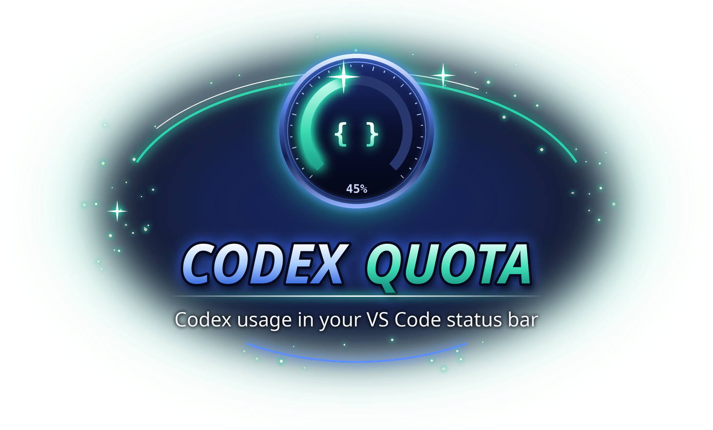

<p align="center"></p>

# Codex Quota

Show Codex quota usage in the VS Code status bar.

## Install

Requires VS Code 1.74.0 or newer. Download **codex-quota-0.9.2.vsix** from the
[EVILE project page](https://evile.uk/redesign/projects/codex-quota/).

1. Open **Extensions → … → Install from VSIX…**.
2. Select the downloaded file.
3. Run **Developer: Reload Window** if the extension has not appeared.

Or install from a terminal:

```sh
code --install-extension codex-quota-0.9.2.vsix
```

Show your current [OpenAI Codex](https://developers.openai.com/codex/) quota usage in the VS Code status bar.

```
$(pulse) Codex 5h 82% · W 61%
```

Percentages mean **remaining** quota: `5h 82%` is 82% left in the 5-hour window, `W 61%` is 61% left in the weekly window.

## What it does

On activation (and on a timer), the extension:

1. Starts the official local `codex app-server` process over stdio.
2. Performs the JSON-RPC handshake (`initialize` → `initialized`).
3. Calls the read-only `account/rateLimits/read` method.
4. Renders the remaining percentages in the status bar.
5. Terminates the app-server process.

Only the focused VS Code window polls; other windows catch up when they regain focus. Clicking the status bar item refreshes immediately. Double-clicking it opens the Codex usage dashboard ([chatgpt.com/codex/settings/usage](https://chatgpt.com/codex/settings/usage)) in your browser; the same page is available via **Codex Quota: Open Usage Page**.

Banked rate-limit resets (granted by referrals or promotions) show as a line in the hover tooltip when the account has any; they are deliberately kept off the status bar. Purchased ChatGPT credits are **not** exposed by the local Codex app-server, so this extension cannot show them; they are listed on the usage dashboard.

## Status bar colors

The background color reflects the most constrained window (the lowest remaining percentage across the shown windows), using the thresholds from `codexQuota.thresholds` (defaults shown):

| Lowest remaining | Appearance |
| --- | --- |
| below `redBelowPercent` (10) | dark red background tint |
| below `amberBelowPercent` (30) | amber background tint |
| at or above `amberBelowPercent` | green text |

Example of moving the bands:

```json
"codexQuota.thresholds": {
  "redBelowPercent": 5,
  "amberBelowPercent": 50
}
```

Changes apply immediately — no reload needed.

VS Code only allows extensions two status bar background colors at all (`statusBarItem.errorBackground` and `statusBarItem.warningBackground`); every other background id is silently dropped by the extension host, so a green background is not possible. The healthy state is therefore signaled with green text (`#2EA043`, chosen to stay readable on both dark and light themes).

The red and amber tints are translucent theme colors. If you prefer solid fills, override them:

```json
"workbench.colorCustomizations": {
  "statusBarItem.errorBackground": "#8B2323",
  "statusBarItem.warningBackground": "#9A6700"
}
```

High-contrast themes deliberately get no background fill. When data is unavailable the colors are cleared.

## Requirements

- VS Code 1.74+
- The official Codex CLI, installed and on VS Code's `PATH` (or set `codexQuota.codexPath`), logged in (`codex login`). When the setting is left at its default, the extension also discovers the current Codex binary bundled with the installed OpenAI ChatGPT extension, so extension updates do not leave a stale versioned path behind.

## Installation

```bash
code --install-extension codex-quota-<version>.vsix
```

Then run `Developer: Reload Window` if the status bar item does not appear.

## Settings

| Setting | Default | Description |
| --- | --- | --- |
| `codexQuota.codexPath` | `codex` | Path to the `codex` executable. Set this if VS Code does not inherit your shell `PATH`. |
| `codexQuota.refreshIntervalSeconds` | `60` | Refresh interval in seconds (minimum 15). |
| `codexQuota.thresholds` | `{ "redBelowPercent": 10, "amberBelowPercent": 30 }` | Color-band thresholds in percent remaining: below `redBelowPercent` shows the red tint, below `amberBelowPercent` the amber tint, otherwise green text. Red is checked first; values are clamped to 0–100. |

## Security / privacy design

This extension **does**:

- start the official local Codex app-server (`codex app-server`) as a child process
- request Codex rate-limit/quota metadata from it over local stdio
- show that data in the VS Code status bar

This extension **does not**:

- read Codex credential files (`~/.codex/auth.json` and friends)
- read Codex session files
- read workspace source code
- send telemetry
- send credentials anywhere
- make independent HTTP/network requests
- invoke Codex model prompts or consume quota

Because the extension launches the official Codex CLI under your own account, the Codex process itself performs whatever authenticated communication Codex requires. This extension only reads the rate-limit metadata that Codex returns and renders it locally.

## Troubleshooting

- `$(warning) Codex ?` means the last refresh failed; hover the item for the reason. `$(key) Codex ?` means Codex is not logged in.
- Check the CLI works in a terminal:

  ```bash
  codex --version
  codex app-server --help
  ```

- If `codex` is not found from within VS Code (e.g. VS Code was launched from the desktop and does not inherit your shell `PATH`), point `codexQuota.codexPath` at the absolute path of the `codex` executable. An explicitly configured path takes precedence over automatic discovery.
- If you are not logged in, run `codex login` in a terminal; this extension never performs authentication.
- The `Codex Quota` output channel (View → Output) contains sanitized status lines (fixed failure reason codes, no response data).

## Privacy and workspace trust

This extension is disabled in untrusted and virtual workspaces. Set `codexQuota.codexPath` in **User settings**; project settings cannot choose an executable. The CLI runs with your local account permissions.
No telemetry is sent by this extension. Review provider-specific credential
handling above. Never include keys, tokens or account responses in bug reports.

## Licence

Copyright © 2026 Richard Beech / 1larity. User-owned code, documentation and assets
are licensed under [Creative Commons Attribution-NonCommercial-ShareAlike 4.0
International](https://creativecommons.org/licenses/by-nc-sa/4.0/)
(**CC BY-NC-SA 4.0**). Credit the author and source, link the licence, indicate
changes, use non-commercially and share adaptations under the same licence.
Third-party material retains its own terms; previous licence grants are not revoked.
See [LICENSE](LICENSE) for the legal text.

## Developer guide

The extension is plain CommonJS JavaScript with **no runtime npm dependencies**
and no compilation step. Use Node.js 22+ for development.

```sh
npm test
node --check extension.js
npx --yes @vscode/vsce@4.0.0 package --no-dependencies
```

Open the checkout in VS Code and press **F5** to launch an Extension Development
Host. Tests run locally with synthetic fixtures; they do not prove live provider
availability or interactive UI acceptance.

- `extension.js`: VS Code integration.
- `lib/` (quota monitors): provider clients, parsers and monitor lifecycle.
- `test/`: offline regression coverage.
- `.vscodeignore`: package allow-list; excludes tests, screenshots, credentials,
  local editor settings, source artwork and previous VSIX files.

See [SECURITY.md](SECURITY.md) for sensitive reporting guidance.
